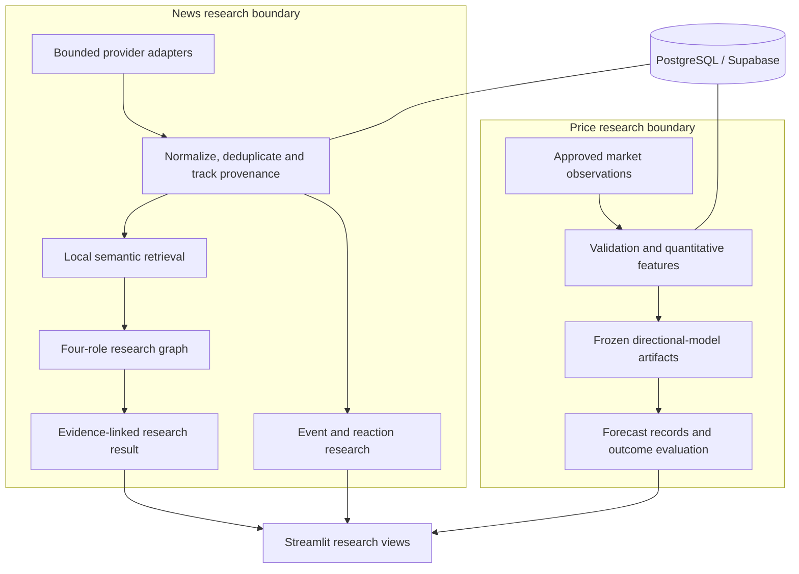

# MarketPulse AI
### An AI/ML research platform for traceable financial analysis

MarketPulse AI explores how modular Python services, machine learning and evidence-based language-model workflows can support financial research. It combines market-data quality controls, directional-model evaluation, a bounded four-role research graph and a Streamlit inspection interface.

The engineering focus is reproducibility: preserve the evidence available at a cutoff, separate observations from interpretations and evaluate recorded forecasts against realized outcomes and simple baselines.

**Portfolio showcase only.** This repository contains independently written project documentation and presentation material. The implementation remains private. This is a research prototype, not financial advice or a trading service. No proven predictive advantage, general agent reliability or currently operating live news service is claimed.

## Architecture

News Impact research and price forecasting remain separate. The diagram does not imply that news-derived features feed frozen price models. The graph orchestrates the existing executor. Provider calls, source validation and request budgets belong to that executor. See [module boundaries](docs/ARCHITECTURE.md).

## Technology stack

| Area | Technologies and role |
| --- | --- |
| Language and contracts | Python, Pydantic, typed research contracts |
| ML research | pandas, NumPy, scikit-learn, XGBoost, Transformers tooling |
| Agent orchestration | LangGraph, LangChain, local-model integration |
| Retrieval | Chroma, sentence embeddings and citation-oriented RAG |
| Persistence | PostgreSQL through Supabase, SQLAlchemy, local SQLite checkpoints |
| Interface | Streamlit, Plotly |
| Packaging | Docker build configuration with a non-root runtime user |
| Quality | pytest, GitHub Actions test workflow, Giskard evaluation experiments |

Tool presence does not establish deployment, live availability or model quality. Docker configuration was inspected, not built for this showcase. Remote CI execution could not be verified in this preparation session.

## Four-role research architecture

1. **Research Coordinator** chooses bounded actions based on available tools and evidence.
2. **API News Collector** uses the approved provider route within its request budget.
3. **Web Discovery and Extraction** addresses permitted evidence gaps when enabled.
4. **Evidence Reviewer** checks evidence decisions and citation references before delivery.

These are runtime responsibilities within a shared graph and executor, not four independently validated autonomous systems. Selected graph tests use injected model/tool responses. Historical local-model evaluations retained quality failures and a negative-control misclassification.

## Existing workflows

- Market observations pass session-date, corporate-action and provider-budget checks before authorized ingestion.
- Price research records forecasts separately from realized outcomes and compares directional results with simple baselines.
- News processing tracks normalization, deduplication, source provenance and availability separately from publication time.
- Retrieval and research views expose evidence-linked results and missing-evidence states.
- News Impact experiments distinguish retrospective evidence from prospective acquisition. Temporal association does not establish causation.

## Testing and CI evidence

**Verification update (17 November 2026):** The private project's release-acceptance record reports successful CI checks for PRs #40 and #41 (9/9 checks on each), and local full-suite results of **1,140 passed, 0 failed, 1 skipped** after integration of PR #42. The #42 pushed commits skipped CI; the local result must not be presented as a fresh CI pass. The skipped test requires a retained real-model evaluation result. Earlier focused testing on 4 November yielded 66 passed and 2 skipped. Offline fixture success is not evidence of live autonomous-agent reliability or production deployment.

The portfolio contains independently authored summaries rather than the private test suite. See the [public evidence update](docs/RESEARCH_STATUS_2026-11-17.md) for scope and limitations.

## Dashboard screenshots

The private Streamlit project now consolidates its research views into one root dashboard (port 8502), including a **Research Sandbox** for a price-only experiment. A separate legacy view (8503) remains temporarily available pending owner confirmation. A restricted, SELECT-only database reader was tested with real stored data, while some sections still display limited-access notices. **No approved public dashboard screenshot is included.** Existing screens may contain licensed news or operational data; any future image requires a synthetic-only, owner-approved session and a separate image audit.

## Skills demonstrated

- Modular Python service design with clear orchestration and transport ownership.
- ML evaluation discipline, baseline comparisons and honest uncertainty reporting.
- Stateful LangGraph orchestration, RAG integration and evidence provenance.
- SQL persistence, additive schema evolution and isolated test design.
- Streamlit research interfaces and Docker / GitHub Actions configuration.
- Security-aware separation of private implementation from public documentation.

## Limitations and roadmap

**Predictive skill has not been demonstrated.** The 17 November private evaluation reports 31.0% accuracy for 29 recorded experimental forecasts versus 65.5% for an always-UP baseline; 28 of the 29 share one anchor date, so independent forward evidence is extremely limited. Historical price-only walk-forward tests for RGLD and AEM also remained below simple majority/always-UP baselines. These are research findings, not evidence of a profitable forecasting model. Canonical forecasting remains `NOT_READY` because indicator data are stale. Live agent research, paid providers, NLP backlog processing and production data refreshes remain approval-gated.

Future work includes more independent forward observations, stronger evaluator negative controls, stricter feature-availability audits, reproducible deployment checks and an approved synthetic dashboard demonstration. These research items do not prevent presenting the existing engineering work in job applications.

## November 2026 research and delivery update

The private project incorporated a consolidated dashboard, a controlled Research Sandbox, additional offline four-role research tests, a selective database-reader audit, data-freshness diagnosis, and documented model comparisons. Operations and security changes that require production approval remain **proposed, not executed**. The public repository does not host the application, its private implementation, or live data access.

- [Research status, quantitative evidence and limitations (17 November 2026)](docs/RESEARCH_STATUS_2026-11-17.md)

## Portfolio material

- [English presentation](presentation/MarketPulse_AI_Portfolio.pptx)
- [Readable presentation narrative](presentation/PRESENTATION.md)
- [English and German application descriptions](career/PROJECT_DESCRIPTIONS_EN_DE.md)
- [Public-content and rights statement](PUBLIC_CONTENT_NOTICE.md)

This showcase provides no installation path to the private system and distributes no implementation source, production datasets, model binaries, credentials or third-party news content.
