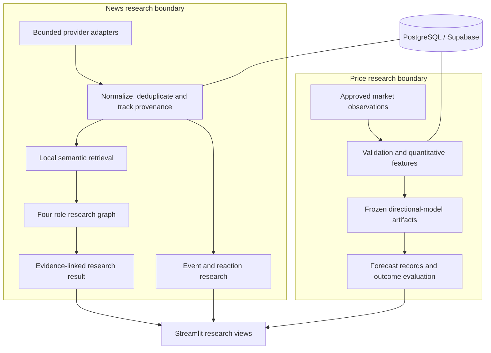

# MarketPulse AI
### An AI/ML research platform for traceable financial analysis

MarketPulse AI explores how modular Python services, machine learning and evidence-based language-model workflows can support financial research. It combines market-data quality controls, directional-model evaluation, a bounded four-role research graph and a Streamlit inspection interface.

The engineering focus is reproducibility: preserve the evidence available at a cutoff, separate observations from interpretations and evaluate recorded forecasts against realized outcomes and simple baselines.

**Portfolio showcase only.** This repository contains independently written project documentation and presentation material. The implementation remains private. This is a research prototype, not financial advice or a trading service. No proven predictive advantage, general agent reliability or currently operating live news service is claimed.

## Architecture

News Impact research and price forecasting remain separate. The diagram does not imply that news-derived features feed frozen price models. The graph orchestrates the existing executor. Provider calls, source validation and request budgets belong to that executor. See [module boundaries](ARCHITECTURE.md).

## Technology stack

| Area | Technologies and role |
| --- | --- |
| Language and contracts | Python, Pydantic, typed research contracts |
| ML research | pandas, NumPy, scikit-learn, XGBoost, Transformers tooling |
| Agent orchestration | LangGraph, LangChain, local-model integration |
| Retrieval | Chroma, sentence embeddings and citation-oriented RAG |
| Persistence | PostgreSQL through Supabase, SQLAlchemy, local SQLite checkpoints |
| Interface | Streamlit, Plotly |
| Packaging | Docker build configuration with a non-root runtime user |
| Quality | pytest, GitHub Actions test workflow, Giskard evaluation experiments |

Tool presence does not establish deployment, live availability or model quality. Docker configuration was inspected, not built for this showcase. Remote CI was verified in November 2026 (see Testing and CI evidence).

## Four-role research architecture

1. **Research Coordinator** chooses bounded actions based on available tools and evidence.
2. **API News Collector** uses the approved provider route within its request budget.
3. **Web Discovery and Extraction** addresses permitted evidence gaps when enabled.
4. **Evidence Reviewer** checks evidence decisions and citation references before delivery.

These are runtime responsibilities within a shared graph and executor, not four independently validated autonomous systems. Selected graph tests use injected model/tool responses. Historical local-model evaluations retained quality failures and a negative-control misclassification.

## Existing workflows

- Market observations pass session-date, corporate-action and provider-budget checks before authorized ingestion.
- Price research records forecasts separately from realized outcomes and compares directional results with simple baselines.
- News processing tracks normalization, deduplication, source provenance and availability separately from publication time.
- Retrieval and research views expose evidence-linked results and missing-evidence states.
- News Impact experiments distinguish retrospective evidence from prospective acquisition. Temporal association does not establish causation.

## Verified results (November 2026)

| Area | Evidence |
| --- | --- |
| End-to-end data path | The dashboard read real stored prices through a dedicated SELECT-only database role with row-level security; every transaction is forced read-only |
| Forecast evaluation | Purged walk-forward test (3-session labels, expanding window, 745 test sessions per asset, 2023–2026): logistic regression and random forest stay **below** an "always up" baseline (RGLD 36.4 % vs 43.9 %, AEM 38.7 % vs 45.1 %); probability scores are worse than class frequencies |
| Recorded forecasts | 29 pre-registered forecasts with realized outcomes: 31.0 % vs 65.5 % for "always up" |
| Conclusion | **No demonstrated predictive edge.** The canonical model stays gated as NOT_READY until fresh macro data and its preflight pass |
| Security review | A database privilege audit found unnecessary API-role privileges; a tested fix with rollback was prepared for owner approval |

Reporting a negative result plainly is a deliberate part of the project: the evaluation pipeline is built to stop weak models, not to market them.

## Testing and CI evidence

**Full suite on GitHub Actions, November 2026: 1,117 passed, 0 failed, 1 skipped**, plus 8 further CI jobs green (Python 3.12, disposable PostgreSQL service, no secrets, no live providers). Getting there was engineering work in its own right:

- The suite had stopped running at all: seven test files imported modules that never reached the main branch, so pytest aborted during collection.
- Integrating the missing research modules (38 files) surfaced and fixed three real defects: a reply/ledger race condition in a local-model evaluation server, a lost transparency caption, and a test network sandbox that also blocked the local test database.
- No test is excluded; an earlier temporary quarantine expired automatically once the code landed.

The one skipped test needs a retained real-model result and never starts inference. Live-provider behaviour is not covered by CI. See [evidence and limits](CAPABILITIES_AND_TESTING.md).

## Dashboard screenshots

The private Streamlit dashboard provides research and evaluation views. **No approved public dashboard screenshot is included.** Existing screens may contain licensed news or operational data. A future screenshot requires an owner-approved synthetic-only session, visible demo labeling and a separate image audit. The architecture and presentation can be used without screenshots.

## Skills demonstrated

- Modular Python service design with clear orchestration and transport ownership.
- ML evaluation discipline, baseline comparisons and honest uncertainty reporting.
- Stateful LangGraph orchestration, RAG integration and evidence provenance.
- SQL persistence, additive schema evolution and isolated test design.
- Streamlit research interfaces and Docker / GitHub Actions configuration.
- Security-aware separation of private implementation from public documentation.

## Limitations and roadmap

Predictive skill remains unproven. Agent quality and evaluator reliability need further work. Live provider operation depends on fresh authorization, account rights and quota evidence. News Impact modeling readiness does not authorize training.

Future work includes more independent forward observations, stronger evaluator negative controls, stricter feature-availability audits, reproducible deployment checks and an approved synthetic dashboard demonstration. These research items do not prevent presenting the existing engineering work in job applications.

## Portfolio material

- [English presentation](MarketPulse_AI_Portfolio.pptx)
- [English and German application descriptions](PROJECT_DESCRIPTIONS_EN_DE.md)
- [Public-content and rights statement](PUBLIC_CONTENT_NOTICE.md)

This showcase provides no installation path to the private system and distributes no implementation source, production datasets, model binaries, credentials or third-party news content.
