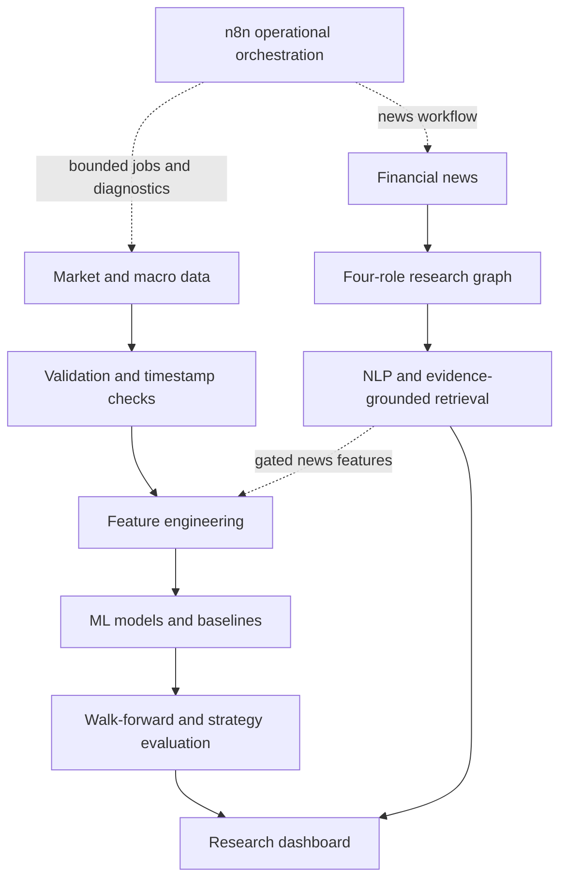

# MarketPulse AI | End-to-End AI Engineering Portfolio

**Agentic AI · LLM/RAG · FastAPI REST APIs · Data Engineering · Machine Learning · Docker · n8n · MCP · CI/CD**

[Explore the bilingual portfolio](index.html) · [Architecture](docs/ARCHITECTURE.md) · [Latest research evidence](docs/RESEARCH_STATUS_2026-11-26.md) · [Presentation](presentation/PRESENTATION.md) · [English/German career profile](career/PROJECT_DESCRIPTIONS_EN_DE.md)

MarketPulse AI is an end-to-end AI/ML research project exploring how market data, economic indicators and financial news can support evidence-based analysis. Its focus is reproducible engineering, rigorous model evaluation and responsible AI—not trading signals or investment recommendations.

This public repository is a curated portfolio case study of a separate private implementation. It contains no private source mirror, credentials, licensed news payloads or raw research datasets.

## AI engineering, backend APIs & MLOps

| Engineering capability | Implemented work |
|---|---|
| **Backend / REST API** | FastAPI, Pydantic request/response validation, OpenAPI schema, health/readiness endpoints, research query and evaluation endpoints; explicit offline and local-RAG modes |
| **LLM application engineering** | LangGraph orchestration, local Ollama/Llama inference, Chroma vector retrieval, embeddings, citation validation, bounded tool execution and abstention |
| **API integrations & ETL** | Market-data and financial-news provider adapters, HTTP request limits, retry/error classification, normalization, deduplication and PostgreSQL persistence |
| **Workflow automation (n8n/MCP)** | Self-hosted visual workflows, FastAPI integration, authorized MCP inspection/manual execution, verified disposable-database NLP run and read-only diagnostics |
| **CI/CD & automation** | GitHub Actions workflow definitions, scheduled ingestion design, read-only smoke tests, execution summaries and sanitized audit artifacts; guarded local PowerShell test and ingestion runners |
| **Containerization & testing** | Docker build/start and HTTP verification for the synthetic API, disposable PostgreSQL 18 integration tests, pytest, browser checks and recorded Giskard contract evaluation |
| **Security & reliability** | Credential isolation, input validation, least-privilege/RLS design, request budgets, process timeouts, evidence checks and reproducible execution receipts |

**API surface:** GET health/readiness, status, source and evaluation routes, OpenAPI documentation; POST research query with typed inputs. The demonstration is loopback-only and does not expose live forecasts, production database writes or unrestricted jobs.

**Delivery evidence:** Docker, HTTP and browser checks were executed locally; the latest supplied regression log reports 1,515 passing tests. GitHub Actions workflows are implemented but cloud CI is currently disabled and successful continuous deployment is not claimed. Local LLM answer quality remains unvalidated; the recorded benchmark failed its acceptance threshold.

## n8n workflow automation — 27 November 2026

A self-hosted Docker-based n8n instance orchestrates seven MarketPulse workflows covering news collection planning, news intelligence, market freshness, system monitoring, database connectivity, pipeline status and NLP testing. MCP integration enables authorized workflow inspection and manual execution. Python/FastAPI retains the business logic; LangGraph retains the four research-agent roles, rather than duplicating them in n8n.

**Verified local milestone:** manual n8n execution 8 processed 10 previously unanalyzed synthetic news records using FinBERT sentiment and topic classification in disposable PostgreSQL: 10 persisted analyses, zero failures, 48.19 seconds. Three records share a headline (eight distinct headlines); content-level deduplication and rerun idempotency remain to be validated. A separate manual connectivity execution verified read-only access to stored news analyses. Live collection, production NLP writes, recurring schedules and end-to-end RAG/agent integration are not yet verified. Forecast NOT_READY; Production NO-GO.

## Research at a glance — 26 November 2026

| Scope | Latest reported offline experiment |
|---|---:|
| Assets across Germany, US-listed markets and London | 14 |
| Forecast horizons (trading sessions) | 1–5 |
| Economic indicators monitored | 7 |
| ML model families evaluated | 5 |
| Out-of-training-sample prediction records | 574,092 |
| Model comparison rows | 3,290 |
| Strategy evaluation rows | 590 |
| Latest reported local regression tests | 1,515 passed / 1 skipped |

Prediction records reuse observations across models and horizons; they are not independent events. The experiment used reconstructed historical snapshots and a previously inspected holdout. Results are exploratory, not prospective validation. The local test count predates subsequent unfinished edits and is not a GitHub CI result.

## Engineering contributions

| Area | Implementation and research |
|---|---|
| Data engineering | OHLCV ingestion, PostgreSQL/Supabase, source timestamps, corporate-action checks, normalization and data-quality diagnostics |
| Machine learning | Logistic Regression, Random Forest, Gradient Boosting, XGBoost and LightGBM; price-only and technical-feature experiments |
| Quantitative research | Expanding chronological folds, target purging, embargo, paired block bootstrap, multiple-testing diagnostics and benchmark comparisons |
| Strategy evaluation | Long/cash portfolio accounting, buy-and-hold and cash benchmarks, momentum, mean reversion, model-based rules, transaction-cost sensitivity and drawdown |
| Agentic AI | Four-role LangGraph research workflow: coordination, API collection, web discovery and evidence review |
| NLP & RAG | Financial sentiment, topic classification, local Llama inference, Chroma retrieval and evidence attribution |
| Application engineering | Streamlit research dashboard, FastAPI demonstration, offline result visualization and reproducible local test workflows |
| Responsible AI | Explicit insufficient-evidence states, bounded provider requests, least-privilege design and no unsupported production claims |

## Architecture

## What the experiments actually demonstrate

The latest offline comparison evaluated price-only and technical-feature tracks across all 14 assets and five horizons. Five ML families were run alongside deterministic baselines. Economic evaluation included transaction-cost assumptions of 0, 10, 20 and 50 basis points per round trip.

**No statistically demonstrated predictive advantage:** no model comparison or strategy comparison passed the reported multiple-testing significance threshold of 5%. Positive historical results are exploratory candidates, not proof of future profitability.

Macro-enhanced and news-enhanced model tracks remain NOT_READY because historical availability and provenance are insufficient. Limited live agent pilots and retained-evidence executions do not establish reliable end-to-end live autonomy.

For methodology, measured limitations and evidence status, see [the dated research update](docs/RESEARCH_STATUS_2026-11-26.md). Earlier findings remain available in the [25 November report](docs/RESEARCH_STATUS_2026-11-25.md) and [17 November report](docs/RESEARCH_STATUS_2026-11-17.md).

## Technology stack

Python · pandas · NumPy · scikit-learn · XGBoost · LightGBM · PostgreSQL · SQLAlchemy · LangChain · LangGraph · n8n · MCP · ChromaDB · Ollama/Llama · NLP · Streamlit · FastAPI · Pydantic · OpenAPI · pytest · Docker · GitHub Actions · PowerShell

## Current status

Research prototype | Forecast NOT_READY | Production NO-GO

Next research priorities: prospective point-in-time data collection, validated news/macro features, independent holdout evaluation and guarded operational scheduling.

## Kurzprofil (Deutsch)

MarketPulse AI ist ein KI- und ML-Forschungsprojekt zur Analyse von Finanzmarktdaten, Wirtschaftsindikatoren und Nachrichten. Der Schwerpunkt liegt auf End-to-End AI Engineering: REST-APIs mit FastAPI und Pydantic, agentenbasierte LLM-Workflows, RAG, Datenpipelines, Docker, n8n-Workflow-Automatisierung, MCP-Integration, automatisierte Tests, CI/CD-Workflows und nachvollziehbare Modellvalidierung. Fünf ML-Modellfamilien wurden für 14 Assets und fünf Prognosehorizonte untersucht. Ein statistisch belastbarer Prognosevorteil wurde bislang nicht nachgewiesen.

## Privacy and responsible publication

Only sanitized aggregate research findings and separately authored portfolio materials are published. No account credentials, private implementation, database contents, licensed news, raw prediction files, model binaries or private execution traces are included. Synthetic examples remain explicitly labeled.

*Research and engineering portfolio only. Not financial advice or an automated trading service.*
