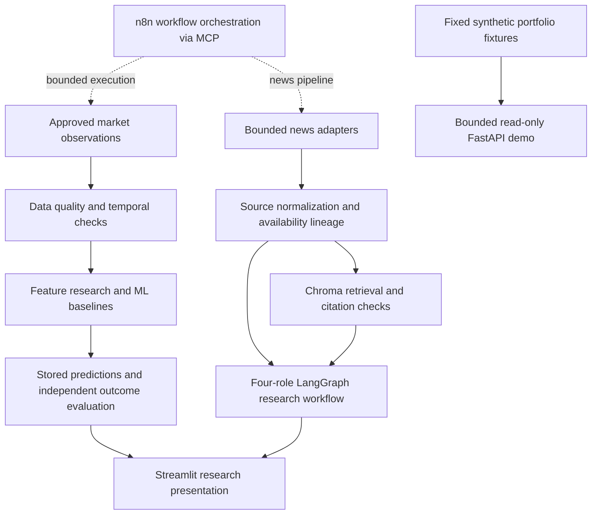

# MarketPulse AI — High-level public architecture

This is a **conceptual description of a privately implemented research system**, not a public-code inventory or runnable deployment diagram. It deliberately excludes infrastructure endpoints and privileged implementation details.

## Operational orchestration

The private local development environment uses self-hosted n8n in Docker with MCP-enabled workflow inspection and manual execution. FastAPI exposes bounded Python services; LangGraph remains responsible for research-agent coordination. A verified manual run processed ten synthetic news records with FinBERT and topic classification in disposable PostgreSQL (ten persisted analyses, zero failures, 48.19 seconds). Production scheduling, live intake and end-to-end RAG integration remain unverified.

## System boundaries

1. **Temporal evidence.** Publication, first-seen, availability, ingestion, association and NLP-completion times are not interchangeable. A historical result must not incorporate evidence that became available after its cutoff.
2. **Forecasting separation.** Historical/news interpretation is not presented as causal proof of price movement. Stored model outputs are tested against simple baselines, without upgrading research models to production.
3. **Four research responsibilities.** Coordination, bounded API news collection, permitted evidence discovery, and evidence review are defined in a shared workflow. Offline contract tests do not establish broad autonomous reliability.
4. **Two demo modes.** The public material is a self-contained static case study. The private software also includes a bounded synthetic FastAPI research demo and a separate local-model evaluation mode; neither implies a live trading API.
5. **Security.** Credentials and database privileges stay outside the public release. The private engineering workflow uses isolated tests and a disposable PostgreSQL environment; this is not a blanket security certification.

The source-controlled model quality report includes negative results. The current product status remains **Forecast NOT_READY** and **Production NO-GO**.